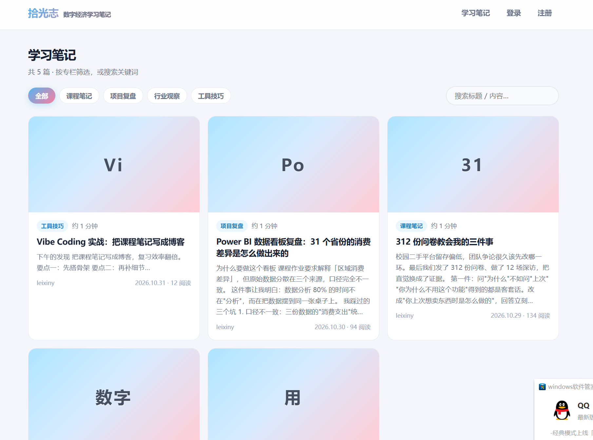

# 拾光志 · 数字经济学习笔记 — 系统介绍文档

> 一个「文章发布 + 分类管理 + 评论互动」的全栈博客系统，按《全栈应用开发》课程方法（设计数据库 → 需求文档 → 后端 API → 前端页面）完成，并在界面与内容上融入了个人设计。

## 一、项目定位

**拾光志**是一个面向数字经济专业学习场景的笔记博客：把课程笔记、项目复盘、行业观察写成公开文章，支持访客浏览、注册登录、发表评论，作者可在线写作与编辑。

- 技术栈：**React 19 + TypeScript + Vite**（前端）｜**Express + JWT + SQLite**（后端）
- 演示账号：`leixiny` / `demo123456`（作者）
- 本地运行：前端 `http://localhost:5174`，后端 API `http://localhost:3001`

## 二、界面导览（对应三张截图）

### 1. 首页 · 落地页


- 纯落地页形态：不直接堆文章，只保留一句定位语「**把学过的东西，写成看得见的成长**」与核心入口
- **「查看笔记 →」渐变主按钮**跳转笔记列表页；未登录访客旁侧显示「注册账号」
- 底部实时统计：笔记数、总阅读次数、专栏数（来自后端接口聚合）
- 背景为个人照片的**高糊化处理**（CSS `blur(34px)` + 提亮 + 降饱和，叠加左浓右淡的白色渐变），保证文字区干净、右侧保留朦胧质感

### 2. 笔记列表页



- **分类胶囊筛选**：全部 / 课程笔记 / 项目复盘 / 行业观察 / 工具技巧，选中态为蓝粉渐变填充
- **关键词搜索**：回车即搜（标题/正文模糊匹配，防抖 400ms）
- **文章卡片**：无封面文章自动生成蓝粉渐变占位封面（取标题前两字），卡片含分类徽章、阅读时长估算、摘要、作者、日期与阅读数
- 每页 9 篇分页；作者本人登录时，自己的文章封面右上角悬浮「✎ 编辑」胶囊

### 3. 文章详情页


- **Markdown 全文渲染**（支持 GFM 表格、删除线等扩展语法），头部展示分类、作者、发布时间、阅读数、阅读时长
- 粉色调**标签系统**（`#Vibe Coding` `#React` 等），点击可反向搜索
- 作者本人可见「**编辑 / 删除**」操作，一键进入带数据回填的编辑页
- 页面底部**评论区**：登录用户可发表（1–1000 字，带字数统计），仅本人可删除自己的评论；未登录显示「登录后参与讨论」提示

## 三、功能清单

| 模块 | 功能 |
| ---- | ---- |
| 用户认证 | 注册 / 登录 / 退出，JWT 鉴权，密码 bcrypt 加密，路由守卫保护写作页 |
| 文章 | 发布、编辑、删除（仅作者本人）、分页浏览、浏览量统计 |
| 分类 | 四个默认专栏，胶囊式筛选 |
| 评论 | 发表 / 列表 / 删除本人评论，未登录只读 |
| 搜索 | 标题与正文关键词模糊搜索 |
| 互动 | 阅读量、阅读时长估算、访客统计 |

## 四、接口设计（核心）

| 方法 | 路径 | 说明 |
| ---- | ---- | ---- |
| POST | /api/auth/register · /login | 注册 / 登录，返回 JWT |
| GET | /api/posts | 列表：分页 + 分类筛选 + 搜索 |
| GET | /api/posts/:id | 详情（浏览量 +1） |
| POST / PUT / DELETE | /api/posts… | 发布 / 编辑 / 删除（JWT + 作者校验） |
| GET / POST | /api/posts/:id/comments | 评论列表 / 发表（JWT） |
| DELETE | /api/comments/:id | 删除本人评论 |

## 五、个人化设计（区别于课程示例）

1. **主题定位**：课程示例是通用博客，本项目锚定「数字经济学习笔记」，四个专栏对应真实学习场景，预置 4 篇真实经历改编的笔记（Power BI 看板复盘、312 份问卷复盘等）
2. **视觉体系**：全站采用个人应援色蓝粉主题（渐变主色 `#56b4ee → #f97fa0`），贯穿按钮、徽章、封面、光晕
3. **首页形态**：落地页 + 单入口按钮，而非传统的"首页即列表"
4. **背景处理**：个人照片高糊化作为首页背景，CSS 实时滤镜实现
5. **细节**：无封面文章自动生成渐变封面、阅读时长估算、字数统计的评论框、作者视角的悬浮编辑键

## 六、项目结构

```
blog-system/
├── database.md          # 数据库设计文档（users / categories / posts / comments）
├── PRD.md               # 需求文档（页面、功能、接口）
├── server/              # Express 后端（路由 / 中间件 / 种子数据）
└── web/                 # React 前端（页面 / 组件 / 认证上下文）
    └── screenshots/     # 提交截图
```
